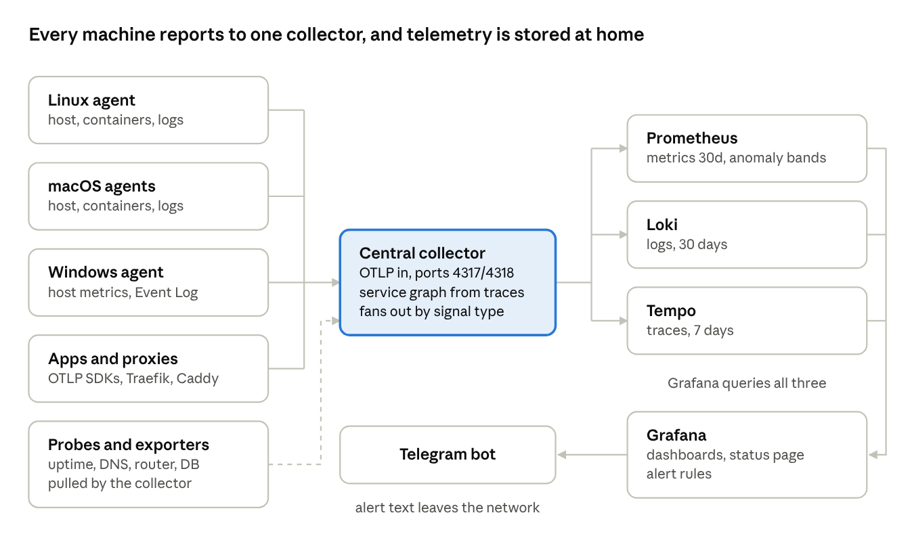

# Home Tracing: Self-Hosted Observability for a Home Lab

Nizanth · October 2026

Status: early version, October 2026. Licensed under Apache-2.0.

Code: [github.com/nizanth/home-observability](https://github.com/nizanth/home-observability)

## Abstract

Home Tracing is a self-hosted observability stack that gives a home lab metrics, logs, traces and alerting from open-source components. The core stack starts with one `docker compose up`; device-specific exporters and database monitoring need editing first. Lightweight OpenTelemetry agents on Linux, macOS and Windows ship data to one central collector, which fans it out to Prometheus, Loki and Tempo. Grafana adds a status page, an end-to-end tracing view and anomaly detection. Anomaly bands compare each signal with its last hour and with the same hour a day and a week earlier. Alerts start after one day of history; the weekly comparison needs a week.

## Motivation

A modern home network runs as many services as a small office, but with none of the tooling. A typical setup mixes a Linux server, a Mac running containers, a Windows PC, a Jellyfin media server, a DNS filter such as AdGuard Home or Pi-hole and a mesh Wi-Fi router. When something breaks, the owner usually finds out from a family member.

Commercial monitoring products are priced and sized for companies, and most send data to a third-party cloud. Home Tracing targets three goals instead:

- **One pane of glass**: every host, container, website and network device on a single status page.
- **Private by default**: all telemetry is stored on the central host. Alert text goes to Telegram, and anonymous usage reports are on by default (see Security).
- **Low effort**: new containers and log files are discovered automatically. Most signals need no hand-tuned thresholds; they alert after a one-day learning period.

## Why watch home traffic

Bots now generate most web traffic, and home devices are increasingly part of it. Imperva's [2025 Bad Bot Report](https://www.imperva.com/resources/resource-library/reports/2025-bad-bot-report/) finds automated traffic at 51% of all web traffic and bad bots at 37%. The report links the growth to AI tools that make bots easier to build.

The home network is a target in two directions:

- **Inbound**: any self-hosted site or app reachable from the internet is scanned and scraped by these bots.
- **Outbound**: compromised home devices are rented out as proxies. The FBI's [June 2025 warning on BADBOX 2.0](https://www.ic3.gov/PSA/2025/PSA250605) describes millions of infected streaming boxes, projectors and picture frames used this way, and lists "unexplained or suspicious Internet traffic" as a sign of infection.

A home owner rarely sees either, because nothing breaks. Learned bands turn quiet changes in traffic into a Telegram message without a threshold for each device.

| What changes | Signal the stack watches | Possible cause |
| --- | --- | --- |
| One device suddenly makes far more DNS queries | DNS queries per client | Malware, a device recruited as a proxy, or a misbehaving app |
| Share of blocked DNS queries jumps | DNS block ratio | A device contacting tracking, ad or malicious domains |
| WAN upload or download moves outside its usual hours or volume | WAN throughput | Proxy or botnet use, an unexpected backup or sync |
| New devices join the network | Connected Wi-Fi devices | An unknown device, or a guest |
| Requests to a self-hosted app spike | Service request rate and log volume | Scanning or scraping bots |
| Network errors or drops rise on a host | Host network errors | A flood, a failing link or a bad cable |

These alerts point at where to look; they do not identify a bot. Telling bots from people needs request detail, such as user agents and paths in reverse-proxy logs, which the stack stores in Loki when the proxy runs in a container.

## Architecture

All telemetry flows through one OpenTelemetry Collector, which routes each signal to a purpose-built store; Grafana reads all three.



Metrics go to Prometheus (30 days by default, set by `METRICS_RETENTION`), logs to Loki (30 days) and traces to Tempo (7 days). The collector runs HTTP uptime probes and builds a service map from trace data. Network devices are covered by small Prometheus exporters that the collector scrapes: a DNS filter exporter, a router exporter and node-exporter for the host's network counters. Host, container and probe data are collected every 30 seconds.

Every component is pinned to a fixed version and configured from files in the repository.

| Component | Version | Memory limit |
| --- | --- | --- |
| Central collector (otelcol-contrib) | 0.130.0 | 512 MiB |
| macOS container agent (otelcol-contrib) | 0.130.0 | 256 MiB |
| Linux, macOS host and Windows agents (otelcol-contrib) | 0.116.0 | 256 MiB |
| Prometheus | v3.1.0 | — |
| Loki | 3.3.2 | — |
| Tempo | 2.7.0 | — |
| Grafana | 11.4.0 | — |
| node-exporter | v1.9.1 | — |

Memory limits are the collectors' `memory_limiter` settings. Open question: the stack's measured footprint (RAM, CPU and disk per day) has not been recorded yet.

## Agents

Each machine runs one OpenTelemetry Collector agent that forwards everything to the central gateway over OTLP. Records carry the machine's host name, so one dashboard can compare machines. The Linux agent is the exception: it reports its container ID instead.

| Agent | Runs as | Collects |
| --- | --- | --- |
| Linux | Docker container | Host CPU, memory and disk; container metrics and logs. Host name is the container ID, and network counters cover only the container's own network |
| macOS host | Root launchd daemon; the install script downloads the official collector binary | Host metrics and app log files |
| macOS containers | Container inside the Docker VM | Container stats and logs, named by container through a small symlink sidecar |
| Windows | Windows service; the PowerShell installer downloads the official collector binary | Host metrics, Windows Event Log (Application, System), app log files |

Of the current agents, only the macOS container agent accepts OTLP from apps, and only on its Docker network. Other apps send OTLP straight to the central collector on ports 4317 and 4318.

On macOS, Docker Desktop and OrbStack hide the real host file system from containers. The container agent therefore runs inside the VM, where container log files are readable. A sidecar refreshes name-to-file links for those logs every 15 seconds.

## Local AI

The stack watches a local LLM server, LM Studio, the same way it watches any other service. Running models at home fits the project's aim: prompts and answers stay on the local network.

Today the coverage is basic. An HTTP probe checks LM Studio's OpenAI-compatible API every 30 seconds, so the server appears on the status page and triggers *Site down* if it stops answering.

```yaml
# otel/collector.yaml
receivers:
  httpcheck:
    targets:
      - { endpoint: "http://<llm-host>:1234/v1/models", method: GET }   # LM Studio
```

The machine running the model is covered by its host agent, so CPU, memory and load show up, with anomaly bands on each. Long inference runs show as sustained load, which is why the bands learn daily patterns rather than using fixed limits.

| Next step | What it adds | How |
| --- | --- | --- |
| Trace apps that call the model | Per-request latency, model name and token counts in Tempo | Instrument the calling app with an OpenTelemetry library that follows the [GenAI semantic conventions](https://opentelemetry.io/docs/specs/semconv/gen-ai/), pointed at the collector |
| Anomaly bands on model latency | An alert when responses slow down, such as a model falling back to CPU | Tag the traced request latency as an `anomaly_type: latency` signal |
| Alert summaries | A short plain-language summary with each Telegram alert | Future work: send the alert to the local model before Telegram |

Keep the LLM server's port on the local network. Like the OTLP ports, it should never be forwarded through the router.

## Dashboards

Three Grafana dashboards are provisioned from version-controlled JSON, so a fresh install looks identical to a running one.

| Dashboard | Question it answers | What it shows |
| --- | --- | --- |
| Home Overview | Is everything up right now? | Overall health, counts, firing alerts, and a table of every service (hosts, containers, websites, database, router, DNS, exporters) with UP/DOWN and time down |
| Traces | Why was this request slow or failing? | A service map, rate / error / p95 latency charts whose dots link to example traces, tables of recent, slow and failed traces, and the logs for the trace you select |
| Anomalies | What is behaving unusually? | Signals outside their learned band now, and each signal plotted against its band |

Service status comes from Prometheus recording rules, not from the dashboard. Alerts and the status page therefore always agree. A service that has been down for more than a day drops off the table, so decommissioned devices do not stay red forever. The same cut-off ends its Container down alert, so an outage longer than a day goes silent.

## Alerting and anomaly detection

Alerting uses two layers: fixed thresholds for clear failures, and learned bands for everything else. All alerts go to a Telegram bot, which works on any phone without opening a port to the internet.

| Alert | Fires when |
| --- | --- |
| Site down | An HTTP probe gets no 2xx or 3xx answer for 2 minutes, or probe data stops arriving |
| Disk almost full | A file system stays over 90% used for 10 minutes |
| Container memory high | A container stays over 90% of its memory limit for 10 minutes |
| Container down | A container that ran at least 30 minutes in the past day is down for 2 minutes; one message per host |
| Anomaly detected | A tagged signal stays outside its learned band for 15 minutes |

Treating missing data as a failure matters: if the collector itself dies, *Site down* fires instead of going quiet.

Anomaly detection uses the adaptive method from Grafana's open-source [promql-anomaly-detection](https://github.com/grafana/promql-anomaly-detection) project, written as Prometheus recording rules. The rules are vendored under Apache-2.0 from Grafana Labs. Each signal's band is the widest of three:

| Band | Built from |
| --- | --- |
| Short term | One-hour mean ± 2 standard deviations, the deviation smoothed over 26 hours |
| Margin | One-hour mean ± 50% |
| Long term | The same hour 1 day and 1 week earlier, each as mean ± 2 standard deviations |

The long-term band keeps a nightly backup or a weekend movie night from being flagged. Errors and latency alert only on increases; their lower band is pinned to zero.

- **Coverage**: host resources, containers, probes, log volume, database, DNS, Wi-Fi, WAN traffic and per-service request, error and latency rates.
- **Learning period**: a series must have existed a day ago before it can alert, so new devices do not raise noise. The weekly comparison takes effect only after a week of history.
- **Noise control**: one message per signal type, repeated at most every 12 hours.
- **Adding a signal**: one recording rule with `anomaly_name`, `anomaly_type` and `subject` labels.

Signals that are normally zero, such as error counts, cannot form a band and stay on threshold alerts.

## Security, privacy and deployment

Telemetry is stored on the central host, but two kinds of data leave the network by default.

- **Alert text**: Telegram messages name hosts, containers and probed URLs.
- **Usage reports**: Grafana, Loki and Tempo send anonymous usage statistics by default, and the repository does not turn them off. The settings are `GF_ANALYTICS_REPORTING_ENABLED=false` for Grafana, `analytics.reporting_enabled: false` for Loki and `usage_report.reporting_enabled: false` for Tempo.

Inside the network, the stack assumes a trusted LAN. These measures limit what an untrusted device can reach or read:

- **Secrets**: passwords, router credentials and the bot token live in a `.env` file that is never committed; the repository ships only `.env.example`.
- **Network exposure**: OTLP ports 4317 and 4318 and Grafana's port 3000 are published on all interfaces, and OTLP has no authentication. Bind them to the LAN address or firewall them, and never forward them through the router.
- **Host firewalls**: Docker-published ports bypass host firewalls such as ufw, so a ufw rule alone does not close them.
- **Untrusted devices**: put IoT and guest devices on a separate network, so they cannot reach the collector or Grafana.
- **Plain-text transport**: agents export with TLS disabled (`tls: insecure`), so telemetry crosses the LAN unencrypted.
- **Sensitive labels**: device inventory metrics carry device names, IP addresses and MAC addresses. Treat dashboards and screenshots as private, or drop those labels before sharing.
- **Retention**: logs are kept for 30 days, metrics for 30 days by default and traces for 7 days, which caps how much history exists on disk.

## Getting started

The core stack starts with one command on the central host, after a few edits for your own devices. First clone the repository and change into it.

1. Copy `.env.example` to `.env` and set `HOST_NAME`, `GRAFANA_ADMIN_PASSWORD` and `POSTGRES_MONITOR_PASSWORD`. Compose refuses to start without them.
2. Edit or remove the device-specific parts: the DNS filter and router exporters, the PostgreSQL receiver and the external Docker network it joins, and the HTTP probe targets.
3. Start the stack, then install one agent per additional machine from the same clone.

```bash
# get the code
git clone https://github.com/nizanth/home-observability.git
cd home-observability

# central host
cp .env.example .env   # then edit it
docker compose up -d

# Linux machine (agents/linux)
GATEWAY_ENDPOINT=<central-host>:4317 docker compose up -d

# macOS host (agents/macos)
sudo ./install.sh <central-host>:4317

# containers on a Mac (agents/macos/containers)
GATEWAY_ENDPOINT=<central-host>:4317 HOST_NAME=<mac-name> docker compose up -d

# Windows, elevated PowerShell (agents\windows)
.\install.ps1 -Gateway <central-host>:4317

# an app that should send traces
OTEL_EXPORTER_OTLP_ENDPOINT=http://<central-host>:4317
```

The macOS container agent also joins an existing Docker network shared with the apps; create it or edit it out first. Containers on that network can send OTLP to the agent instead of the central host.

## Configuration examples

The snippets below are trimmed from the project's files, with every address, name and credential replaced by a placeholder. Values in angle brackets are yours to fill in.

### Core stack

One compose file runs the collector, the three stores and Grafana. Only the collector's OTLP ports and Grafana's port 3000 are published.

```yaml
# docker-compose.yml (core services)
services:
  otel-collector:
    image: otel/opentelemetry-collector-contrib:0.130.0
    command: ["--config=/etc/otelcol/config.yaml"]
    user: "0:0"   # reads docker.sock and container log files
    environment:
      OTEL_RESOURCE_ATTRIBUTES: host.name=${HOST_NAME:?set in .env}
    volumes:
      - ./otel/collector.yaml:/etc/otelcol/config.yaml:ro
      - /var/run/docker.sock:/var/run/docker.sock:ro
      - /var/lib/docker/containers:/var/lib/docker/containers:ro
      - /:/hostfs:ro,rslave
    ports:
      - "4317:4317"   # OTLP gRPC
      - "4318:4318"   # OTLP HTTP
    depends_on: [loki, tempo, prometheus]

  loki:
    image: grafana/loki:3.3.2
    command: ["-config.file=/etc/loki/loki.yaml"]
    volumes: ["./loki/loki.yaml:/etc/loki/loki.yaml:ro", "loki-data:/loki"]

  tempo:
    image: grafana/tempo:2.7.0
    command: ["-config.file=/etc/tempo/tempo.yaml"]
    volumes: ["./tempo/tempo.yaml:/etc/tempo/tempo.yaml:ro", "tempo-data:/var/tempo"]

  prometheus:
    image: prom/prometheus:v3.1.0
    command:
      - --config.file=/etc/prometheus/prometheus.yml
      - --storage.tsdb.retention.time=${METRICS_RETENTION:-30d}
      - --web.enable-remote-write-receiver   # the collector pushes metrics
      - --enable-feature=exemplar-storage    # trace IDs on latency charts
    volumes:
      - ./prometheus/prometheus.yml:/etc/prometheus/prometheus.yml:ro
      - ./prometheus/rules:/etc/prometheus/rules:ro
      - prometheus-data:/prometheus

  grafana:
    image: grafana/grafana:11.4.0
    environment:
      GF_SECURITY_ADMIN_PASSWORD: ${GRAFANA_ADMIN_PASSWORD:?set in .env}
      GF_USERS_ALLOW_SIGN_UP: "false"
      GF_ANALYTICS_REPORTING_ENABLED: "false"   # recommended, see Security
    volumes:
      - ./grafana/provisioning:/etc/grafana/provisioning:ro
      - ./grafana/dashboards:/var/lib/grafana/dashboards:ro
      - grafana-data:/var/lib/grafana
    ports: ["3000:3000"]

volumes: { loki-data: {}, tempo-data: {}, prometheus-data: {}, grafana-data: {} }
```

To publish a port on one interface only, prefix it with the LAN address, for example `"<lan-ip>:3000:3000"`.

### Environment file

Secrets and per-machine names live in `.env`, which stays out of version control.

```bash
# .env  (copy from .env.example; never commit)
HOST_NAME=<this-machine>            # shown in dashboards and alerts
GRAFANA_ADMIN_PASSWORD=<strong-password>
TELEGRAM_BOT_TOKEN=<token-from-botfather>
TELEGRAM_CHAT_ID=<your-chat-id>
METRICS_RETENTION=30d

# optional device exporters
ADGUARD_URL=http://<dns-filter-host>
ROUTER_HOST=<router-host>
ROUTER_USER=<router-user>
ROUTER_PASSWORD=<router-password>
```

### Custom exporter

Devices without a metrics endpoint get a small Python exporter. It polls the device on a timer, because home routers are slow, and serves the last values to Prometheus.

```dockerfile
# Dockerfile
FROM python:3.12-slim
RUN pip install --no-cache-dir prometheus-client==0.21.1 <device-api-client>
COPY exporter.py /exporter.py
USER nobody
EXPOSE 9100
CMD ["python", "-u", "/exporter.py"]
```

```python
# exporter.py (skeleton)
import os, time
from prometheus_client import Gauge, start_http_server

INTERVAL = int(os.environ.get("ROUTER_INTERVAL", "60"))
UP = Gauge("router_up", "1 if the last poll succeeded")
DEVICES = Gauge("router_connected_devices", "Attached devices", ["connection_type"])

def poll():
    # call your device's API here and set the gauges
    ...

if __name__ == "__main__":
    start_http_server(9100)
    while True:
        try:
            poll()
            UP.set(1)
        except Exception:
            UP.set(0)
        time.sleep(INTERVAL)
```

The collector then scrapes it like any other target:

```yaml
# otel/collector.yaml
receivers:
  prometheus:
    config:
      scrape_configs:
        - job_name: router
          scrape_interval: 60s
          static_configs: [{ targets: ["router-exporter:9100"] }]
```

### Telegram alerts

Alerts reach a phone through a private Telegram bot, provisioned as a Grafana contact point.

1. In Telegram, message @BotFather, send `/newbot` and copy the token it returns.
2. Send any message to your new bot.
3. Find your chat ID with the call below, then put the token and ID in `.env`.

```bash
curl -s "https://api.telegram.org/bot<token>/getUpdates" | grep -o '"chat":{"id":[-0-9]*'
```

```yaml
# grafana/provisioning/alerting/alerts.yaml
contactPoints:
  - orgId: 1
    name: home-telegram
    receivers:
      - uid: home-telegram
        type: telegram
        settings:
          bottoken: ${TELEGRAM_BOT_TOKEN}
          chatid: "__TELEGRAM_CHAT_ID__"   # filled in at container start
          parse_mode: HTML

policies:
  - orgId: 1
    receiver: home-telegram
    group_by: [alertname, http_url]
    repeat_interval: 4h
    routes:
      - receiver: home-telegram             # one message per host
        object_matchers: [["alertname", "=", "Container down"]]
        group_by: [alertname, host_name]
      - receiver: home-telegram             # one message per kind of anomaly
        object_matchers: [["alertname", "=", "Anomaly detected"]]
        group_by: [alertname, anomaly_name]
        group_interval: 15m
        repeat_interval: 12h
```

Grafana's own `${VAR}` expansion turns a numeric chat ID into a number and rejects it. The compose file therefore copies the provisioning folder and substitutes the ID as text before Grafana starts:

```yaml
# docker-compose.yml, grafana service
    environment:
      TELEGRAM_BOT_TOKEN: ${TELEGRAM_BOT_TOKEN:-}
      TELEGRAM_CHAT_ID: ${TELEGRAM_CHAT_ID:-}
      GF_PATHS_PROVISIONING: /tmp/provisioning
    entrypoint:
      - sh
      - -c
      - rm -rf /tmp/provisioning &&
        cp -r /etc/grafana/provisioning /tmp/provisioning &&
        sed -i "s/__TELEGRAM_CHAT_ID__/$$TELEGRAM_CHAT_ID/" /tmp/provisioning/alerting/alerts.yaml &&
        exec /run.sh
```

### Anomaly detection

A signal joins anomaly detection through one recording rule. Its labels name the signal, choose how it is judged, and say what it describes.

```yaml
# prometheus/rules/anomaly-home.yml
groups:
  - name: AnomalyInputsHost
    rules:
      - record: anomaly:input:host_cpu
        expr: >-
          label_join(100 * (1 - avg by (host_name) (system_cpu_utilization{state="idle"})),
                     "subject", " ", "host_name")
        labels:
          anomaly_name: host_cpu
          anomaly_type: resource      # resource | requests | latency | errors
          anomaly_strategy: adaptive
```

The vendored adaptive rules turn each input into `anomaly:level`, `anomaly:upper_band` and `anomaly:lower_band`. One Grafana alert then checks every signal at once:

```yaml
# grafana/provisioning/alerting/alerts.yaml
      - uid: anomaly-detected
        title: Anomaly detected
        for: 15m
        labels: { severity: info }
        annotations:
          summary: "{{ $labels.anomaly_name }} · {{ $labels.subject }} is {{ $labels.direction }} its normal range (now {{ humanize $values.B.Value }})"
        data:
          - refId: A
            datasourceUid: prometheus
            model:
              instant: true
              expr: |-
                max by (anomaly_name, anomaly_type, subject, direction) (
                  label_replace(
                    last_over_time(anomaly:level[2m]) > last_over_time(anomaly:upper_band{anomaly_strategy="adaptive"}[2m]),
                    "direction", "above", "", "")
                  or
                  label_replace(
                    last_over_time(anomaly:level[2m]) < last_over_time(anomaly:lower_band{anomaly_strategy="adaptive"}[2m]),
                    "direction", "below", "", "")
                )
                # learning period: only series that already existed a day ago
                and on (anomaly_name, subject)
                max by (anomaly_name, subject) (last_over_time(anomaly:adaptive:select[1h] offset 1d))
```

A resulting Telegram message looks like this (illustrative values):

```text
Firing: Anomaly detected
host_cpu · server-1 is above its normal range (now 87.4)
Dashboard: Home > Anomalies (anomaly_name=host_cpu)
```

### Uptime probes and app traces

A website joins the status page and the *Site down* alert by adding one probe target to the collector.

```yaml
# otel/collector.yaml
receivers:
  httpcheck:
    collection_interval: 30s
    targets:
      - { endpoint: "http://host.docker.internal:<port>/", method: GET }   # an app on the central host
      - { endpoint: "http://<device-host>/", method: GET }                 # a device on the LAN
```

An app sends traces by pointing any OpenTelemetry SDK at the collector:

```bash
export OTEL_EXPORTER_OTLP_ENDPOINT=http://<central-host>:4317
export OTEL_SERVICE_NAME=<app-name>
```

## Alternatives

Home Tracing differs from similar tools by keeping metrics, logs and traces in the standard Grafana stores, fed by upstream OpenTelemetry Collectors.

| Tool | What it is | What Home Tracing does differently |
| --- | --- | --- |
| Netdata | Monitoring agent with built-in dashboards | Uses OpenTelemetry agents and stores data in Prometheus, Loki and Tempo |
| Uptime Kuma | Uptime checks and status pages | Adds host, container, log and trace data; uptime probes are one input |
| SigNoz | OpenTelemetry-native observability platform | Uses Grafana, Prometheus, Loki and Tempo, plus home-network exporters and anomaly rules |
| Grafana Alloy | Grafana's distribution of the OpenTelemetry Collector | Uses the upstream otelcol-contrib build; Alloy could replace it |

## Limitations and future work

- **No transport security on OTLP**: agents send in plain text and the gateway accepts anyone. Future work is TLS plus a bearer token (the collector's bearertokenauth extension).
- **Single central host**: storage and Grafana run on one machine, which is itself a single point of failure. An external heartbeat check would cover that gap.
- **No host-down alert**: a machine that stops reporting shows as down on the status page, but no alert fires. Container down covers only machines that run containers.
- **Linux agent identity**: it reports its container ID as host name and sees only its own network. Setting `host.name` and adding node-exporter, as the central host does, would fix this.
- **Off-the-shelf apps**: apps without native OpenTelemetry, such as Jellyfin and most other media servers, give only logs and uptime. Per-request traces come from putting a tracing reverse proxy (Traefik or Caddy) in front of them.
- **Zero-valued signals**: error rates that are normally zero cannot be learned and need threshold rules.
- **Platform gaps**: full host metrics on macOS need the native agent; containers on Docker Desktop or OrbStack cannot see the host's real file system.
- **Short-lived containers on macOS**: the log-links sidecar rescans every 15 seconds, so logs from containers that live less than that can be missed.
- **Footprint not measured**: RAM, CPU and disk use per day are an open question.

## Conclusion

Home Tracing shows that a home lab can run metrics, logs, traces, a status page and anomaly alerts on open-source parts. One compose file, one agent per machine and a handful of rule files cover three operating systems. Every dashboard and rule is versioned in the repository, so the setup is reproducible and telemetry is stored at home.

## References

- [OpenTelemetry Collector](https://opentelemetry.io/docs/collector/)
- [grafana/promql-anomaly-detection](https://github.com/grafana/promql-anomaly-detection)
- [Imperva 2025 Bad Bot Report](https://www.imperva.com/resources/resource-library/reports/2025-bad-bot-report/)
- [FBI PSA I-060525-PSA: BADBOX 2.0](https://www.ic3.gov/PSA/2025/PSA250605)
- [OpenTelemetry GenAI semantic conventions](https://opentelemetry.io/docs/specs/semconv/gen-ai/)
- [Prometheus](https://prometheus.io/docs/introduction/overview/)
- [Grafana Loki](https://grafana.com/docs/loki/latest/)
- [Grafana Tempo](https://grafana.com/docs/tempo/latest/)
- [Grafana](https://grafana.com/docs/grafana/latest/)
